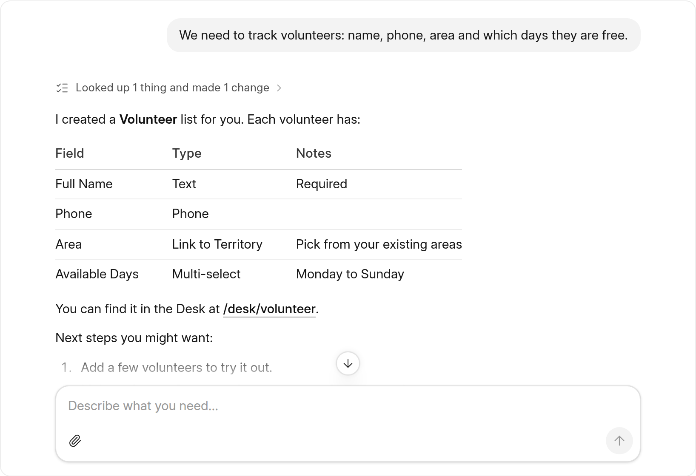

# frappe-ui AI Elements

[](https://www.npmjs.com/package/frappe-ui-ai-elements)
[](https://github.com/bwhtech/frappe-ui-ai-elements/actions/workflows/ci.yml)
[](LICENSE)

Vue 3 components for AI chat and agent interfaces, built on [frappe-ui](https://github.com/frappe/frappe-ui). This is a port of [shadcn AI Elements](https://ui.shadcn.com/docs/ai-elements). The components use frappe-ui components and design tokens, so a chat looks like the rest of a Frappe app, in light and dark mode.

The components read the message format of the [Vercel AI SDK](https://ai-sdk.dev): `UIMessage` and its parts. One component, `MessageParts`, renders a whole message: text, reasoning, files, sources and tool calls in each of their states.

**[Gallery](https://bwhtech.github.io/frappe-ui-ai-elements/)** · **[Playground](https://bwhtech.github.io/frappe-ui-ai-elements/playground.html)** · **[Changelog](CHANGELOG.md)**



## Contents

- [What you get](#what-you-get)
- [Install](#install)
- [Set up](#set-up)
- [Quick start](#quick-start)
- [Recipes](#recipes)
- [Reference](#reference)
- [Differences from shadcn](#differences-from-shadcn)
- [Contribute](#contribute)

## What you get

- **A chat that scrolls correctly.** The reply follows while the reader is at the end. The person's new message stays near the top. A scroll up by the reader stops the follow. Older messages load above without a jump.
- **Tool calls in every state.** Each call shows as one line: preparing, running, done, failed, denied or stopped. A run of steps folds under one line, such as "Looked up 4 things and made 2 changes".
- **Approvals.** A call that needs permission shows Approve and Deny. Two or more waiting calls get "Approve all". An app can add "Always allow".
- **Questions and plans from the agent.** The agent can ask the person questions (`ask_user`) and propose a plan for approval (`propose_plan`). Each one has a ready-made card.
- **Markdown replies.** Code blocks with highlighting, tables, LaTeX maths (KaTeX), Mermaid diagrams and citation chips. A reply renders correctly while it streams.
- **A prompt input.** Files from a button, a drop or a paste. Send, Stop and Queue. A queue of messages that the person writes while the agent works. A model picker.
- **More elements from shadcn.** Reasoning, Task, Plan, Queue, Chain of Thought, Sources, Inline Citation, Context, Checkpoint, File Tree, Terminal, Stack Trace, Test Results and Subagent.

The package is written in TypeScript and ships type declarations.

## Install

```bash
npm install frappe-ui-ai-elements frappe-ui vue
```

To use the chat with the AI SDK, also install it:

```bash
npm install ai @ai-sdk/vue
```

| Peer dependency | Version            | Note                                     |
| --------------- | ------------------ | ---------------------------------------- |
| `vue`           | 3.5 or later       |                                          |
| `frappe-ui`     | 1.1 or a later 1.x |                                          |
| `ai`            | 7 or later         | Optional. Most elements work without it. |

The package also installs [KaTeX](https://katex.org) for maths and [Pele](https://pele.run) for Mermaid diagrams. Pele loads only when a reply has a diagram.

## Set up

1. Use Tailwind 3 with the frappe-ui preset. Add this package's files to `content`, so Tailwind generates the classes that the components use:

   ```js
   // tailwind.config.js
   import preset, { content as frappeUI } from "frappe-ui/tailwind";
   import { content as aiElements } from "frappe-ui-ai-elements/tailwind";

   export default {
   	presets: [preset],
   	content: [...frappeUI, ...aiElements, "./src/**/*.{vue,ts}"],
   };
   ```

2. Import the styles after the frappe-ui styles. Import them from a CSS file that Tailwind processes, because the file uses `@layer utilities`:

   ```css
   @import "frappe-ui/style.css";
   @import "frappe-ui-ai-elements/styles.css";
   ```

3. Put your app inside the frappe-ui `<FrappeUIProvider>`.

The styles file holds the `shimmer`, `scroll-fade-*`, `ease-out-strong` and `touch-target` utilities, the code highlighting theme and a few structural selectors. `Response` imports the KaTeX stylesheet itself. Vite and other bundlers that handle CSS imports need no more setup.

## Quick start

This component is a complete chat. It sends text and files, streams the reply, and lets the person approve tool calls and stop a reply.

```vue
<script setup lang="ts">
import { useChat } from "@ai-sdk/vue";
import { DefaultChatTransport, lastAssistantMessageIsCompleteWithApprovalResponses } from "ai";
import {
	Conversation,
	ConversationContent,
	ConversationItem,
	ConversationScrollButton,
	Message,
	MessageContent,
	MessageParts,
	PromptInput,
	PromptInputAttachButton,
	PromptInputFooter,
	PromptInputHeader,
	PromptInputSubmit,
	PromptInputTextarea,
	PromptInputTools,
} from "frappe-ui-ai-elements";
import { ref } from "vue";

const { messages, sendMessage, addToolApprovalResponse, status, stop } = useChat({
	transport: new DefaultChatTransport({ api: "/api/chat" }),
	// Send again as soon as the person answers every approval.
	sendAutomaticallyWhen: lastAssistantMessageIsCompleteWithApprovalResponses,
});
const draft = ref("");

function send({ text, files }: { text: string; files: File[] }) {
	sendMessage(files.length ? { text, files: toFileList(files) } : { text });
}

// PromptInput gives File[]. The AI SDK takes a FileList.
function toFileList(files: File[]) {
	const transfer = new DataTransfer();
	for (const file of files) transfer.items.add(file);
	return transfer.files;
}
</script>

<template>
	<div class="flex h-screen flex-col">
		<Conversation class="min-h-0 flex-1">
			<ConversationContent class="mx-auto w-full max-w-3xl px-4 py-6">
				<ConversationItem v-for="message in messages" :key="message.id" :message-id="message.id" :scroll-anchor="message.role === 'user'">
					<Message :from="message.role">
						<MessageContent :bare="message.role === 'user'">
							<MessageParts
								:message="message"
								:streaming="status === 'streaming' && message === messages.at(-1)"
								@approve="(id) => addToolApprovalResponse({ id, approved: true })"
								@deny="(id) => addToolApprovalResponse({ id, approved: false })"
							/>
						</MessageContent>
					</Message>
				</ConversationItem>
			</ConversationContent>
			<ConversationScrollButton />
		</Conversation>

		<div class="mx-auto w-full max-w-3xl px-4 pb-4">
			<PromptInput v-model="draft" :status="status" @submit="send" @stop="stop">
				<PromptInputHeader />
				<PromptInputTextarea placeholder="Ask anything" autofocus />
				<PromptInputFooter>
					<PromptInputTools>
						<PromptInputAttachButton />
					</PromptInputTools>
					<PromptInputSubmit />
				</PromptInputFooter>
			</PromptInput>
		</div>
	</div>
</template>
```

Some notes about this example:

- `scroll-anchor` on the person's turns keeps each new question near the top while the reply streams under it.
- `bare` on the person's turns lets `MessageParts` draw the bubble. It then puts attached files in a row under the bubble.
- `streaming` goes only to the last message. A tool call that is still open in an older message then shows as stopped.
- `PromptInputHeader` shows the attached files before the person sends them.

## Recipes

### Ask before a tool runs

Give the tool `needsApproval` on the server. The call then arrives in the state `approval-requested`, and `MessageParts` shows a card with Approve and Deny. The quick start already sends the answers. When two or more calls wait in one message, a bar with "Approve all" and "Deny all" shows above the first card.

```ts
// On the server
import { tool } from "ai";
import { z } from "zod";

const deleteRecord = tool({
	description: "Delete a record",
	inputSchema: z.object({ doctype: z.string(), name: z.string() }),
	needsApproval: true,
	execute: async ({ doctype, name }) => remove(doctype, name),
});
```

The card shows a short summary of what the call acts on, such as "Volunteer · VOL-0042". "Show details" opens the full input.

### Give tools their own names, and "Always allow"

By default, a tool line reads "Ran create document" for a tool called `create_document`. To show your own names, provide a labeler. It runs for each tool name, and returns `undefined` to keep the default.

```ts
import { provideToolLabels } from "frappe-ui-ai-elements";

provideToolLabels((toolName) => {
	const [server, action] = toolName.split("__");
	if (!action) return undefined;
	return {
		title: `${titleCase(server)} · ${titleCase(action)}`, // "Linear · Create issue"
		question: `Allow ${titleCase(server)} to ${action.replaceAll("_", " ")}?`,
		// Shows "Always allow" on the approval card. The card approves the call after this resolves.
		alwaysAllow: () => saveRule(toolName, "allow"),
	};
});
```

Call `provideToolLabels` in a component above the messages, such as the chat page.

### Draw one of your tools your own way

A tool can render with your own component instead of a line. The component gets the tool part and whether the reply streams.

```vue
<!-- WeatherCard.vue -->
<script setup lang="ts">
import type { ToolMessagePart } from "frappe-ui-ai-elements";

defineProps<{ part: ToolMessagePart; streaming: boolean }>();
</script>

<template>
	<div v-if="part.state === 'output-available'" class="rounded-6 border border-outline-gray-2 p-3">
		{{ (part.output as { summary: string }).summary }}
	</div>
</template>
```

```ts
import { provideToolRenderers } from "frappe-ui-ai-elements";
import WeatherCard from "./WeatherCard.vue";

provideToolRenderers({ get_weather: WeatherCard });
```

A call that waits for approval still shows the approval card first. A tool that you draw does not fold into a group of steps. If your component draws one plain line, name the tool in `foldable`, so that it folds with the steps around it:

```ts
provideToolRenderers({ get_weather: WeatherLine }, { foldable: ["get_weather"] });
```

### Ask the person questions (`ask_user`)

The agent can ask one or more questions with a tool that runs in the browser. Define the tool on the server without `execute`. `MessageParts` shows the call as a questionnaire and emits `answer` when the person submits. Give the answer to the AI SDK:

```ts
import { lastAssistantMessageIsCompleteWithApprovalResponses, lastAssistantMessageIsCompleteWithToolCalls } from "ai";

const { addToolOutput } = useChat({
	sendAutomaticallyWhen: (options) => lastAssistantMessageIsCompleteWithApprovalResponses(options) || lastAssistantMessageIsCompleteWithToolCalls(options),
});
```

```vue
<MessageParts
	:message="message"
	@answer="({ toolCallId, output }) => addToolOutput({ tool: 'ask_user', toolCallId, output })"
	@dismiss="(toolCallId) => addToolOutput({ tool: 'ask_user', toolCallId, state: 'output-error', errorText: 'Not answered' })"
/>
```

The tool input (`AskUserInput`):

| Field                     | Type                                                      | Notes                                                                                                                                                                                       |
| ------------------------- | --------------------------------------------------------- | ------------------------------------------------------------------------------------------------------------------------------------------------------------------------------------------- |
| `title`                   | `string?`                                                 | Shows above the questions.                                                                                                                                                                  |
| `questions`               | `AskUserQuestion[]`                                       | One or more. One to four is best.                                                                                                                                                           |
| `questions[].id`          | `string`                                                  | Unique in the call. The answer uses it as its key.                                                                                                                                          |
| `questions[].header`      | `string?`                                                 | A short step label, such as "Fields".                                                                                                                                                       |
| `questions[].question`    | `string`                                                  | The question.                                                                                                                                                                               |
| `questions[].description` | `string?`                                                 | Help text under the question.                                                                                                                                                               |
| `questions[].kind`        | `single \| multiple \| text \| number \| date \| boolean` | The type of answer. It sets the control.                                                                                                                                                    |
| `questions[].options`     | `{ value, label, description? }[]`                        | Required for `single` and `multiple`. Up to 6 show as rows with number keys. More show as a Select (`single`, up to 12), a Combobox (`single`, more than 12) or a MultiSelect (`multiple`). |
| `questions[].allowOther`  | `boolean?`                                                | Adds an "Other…" text answer to `single` and `multiple`.                                                                                                                                    |
| `questions[].required`    | `boolean?`                                                | Defaults to `true`. An optional question shows Skip.                                                                                                                                        |
| `questions[].placeholder` | `string?`                                                 | For `text`, `number`, `date` and the "Other…" field.                                                                                                                                        |

The output (`AskUserOutput`) is `{ answers: Record<id, answer> }`. An answer is an option `value` (`single`), an array of values (`multiple`), a string (`text`), a number (`number`), `"YYYY-MM-DD"` (`date`), `true` or `false` (`boolean`), or `null` for a skipped question.

**Every call needs a result.** The provider rejects a thread with a tool call that has no result. Close an open `ask_user` call in two cases:

- The person clicks "Not now". `MessageParts` emits `dismiss`, as in the example above.
- The person writes in the chat instead of answering. Before `sendMessage`, close each id from `openAskUserCalls(messages)` with `state: "output-error"`.

An input that does not match the shape above renders as a normal tool line. Check the same rules on the server, so the AI SDK sends a bad call back to the model to fix. `parseAskUserInput`, `toAskUserOutput`, `parseAskUserOutput`, `formatAskUserAnswer` and `openAskUserCalls` are exported.

### Propose a plan, then build it (`propose_plan`, `update_plan`)

Before the agent builds several things, it lists them with a `propose_plan` tool. The person approves the whole plan once. Define the tool on the server without `execute`, as for `ask_user`:

```vue
<MessageParts :message="message" @decide="({ toolCallId, output }) => addToolOutput({ tool: 'propose_plan', toolCallId, output })" />
```

While it builds, the agent marks items with an `update_plan` tool, which has an `execute` on the server. To tick items off on the plan card, provide the latest plan of the thread:

```ts
import { currentPlan, provideBuildPlan } from "frappe-ui-ai-elements";

provideBuildPlan(computed(() => currentPlan(messages.value)));
```

| Shape                 | Value                                                                                                                           |
| --------------------- | ------------------------------------------------------------------------------------------------------------------------------- |
| `propose_plan` input  | `{ title, items: { id, kind, title, detail? }[] }`. `kind` is `table`, `role`, `web_form`, `studio_page`, `records` or `other`. |
| `propose_plan` output | `{ approved: true }` or `{ approved: false, feedback }`                                                                         |
| `update_plan` input   | `{ updates: { id, status: in_progress \| done \| skipped, note? }[] }`                                                          |

With an approved plan, `MessageParts` puts the steps of each item under one line with the item's title and status. It hides the `update_plan` calls. `isBuilding(plan)` is true for an approved plan with items left. `openPlanCalls(messages)` lists plans that wait for the person.

### Open files in your own viewer

Attachment chips and image thumbnails are links. They open in a new tab. To open them in your own viewer, such as a side panel, provide a viewer. It returns `true` when it opens the file, and `false` to let the link open.

```ts
import { provideFileViewer } from "frappe-ui-ai-elements";

provideFileViewer((file) => {
	if (file.mediaType !== "application/pdf" && !file.mediaType.startsWith("image/")) return false;
	sidePanel.open(file); // { name, url, mediaType }
	return true;
});
```

A click with Ctrl, Cmd, Shift or the middle button always opens the link. For a file link of your own, `useViewOnClick()` gives the same click handler.

### Queue messages while the agent works

With `queue`, the person can send while a reply streams. The page keeps the list and sends the first item when the agent is free. Steer means "stop the reply and send this now".

```vue
<script setup lang="ts">
import { useChat } from "@ai-sdk/vue";
import { PromptInput, PromptInputQueue, PromptInputSubmit, PromptInputTextarea, type QueuedMessage } from "frappe-ui-ai-elements";
import { ref, watch } from "vue";

const { sendMessage, status, stop } = useChat();
const queued = ref<QueuedMessage[]>([]);
const editing = ref<string | null>(null);
const draft = ref("");

function add({ text }: { text: string }) {
	if (status.value === "ready") sendMessage({ text });
	else queued.value.push({ id: crypto.randomUUID(), text });
}

function take(id: string) {
	const item = queued.value.find((candidate) => candidate.id === id);
	queued.value = queued.value.filter((candidate) => candidate.id !== id);
	return item;
}

// When the reply ends, send the next message. A row that the person edits waits.
watch(status, (now) => {
	const next = queued.value.find((item) => item.id !== editing.value);
	if (now === "ready" && next) sendMessage({ text: take(next.id)!.text });
});

async function steer(id: string) {
	const item = take(id);
	await stop();
	if (item) sendMessage({ text: item.text });
}
</script>

<template>
	<PromptInputQueue
		v-model:editing="editing"
		:items="queued"
		@steer="steer"
		@remove="take"
		@update="(id, text) => (queued.find((item) => item.id === id)!.text = text)"
		@reorder="(ids) => (queued = ids.map((id) => queued.find((item) => item.id === id)!))"
	/>
	<PromptInput v-model="draft" :status="status" queue @submit="add" @stop="stop">
		<PromptInputTextarea />
		<PromptInputSubmit />
	</PromptInput>
</template>
```

While a reply streams, the submit button shows Queue when the field has text, and Stop when it is empty.

### Let the person pick a model

`ModelSelector` is a searchable list, grouped by provider. `v-model` is the id of the chosen option.

```vue
<script setup lang="ts">
import { ModelSelector, PromptInputAttachButton, PromptInputTools, type ModelOption } from "frappe-ui-ai-elements";
import { ref } from "vue";

const models: ModelOption[] = [
	{ id: "claude-sonnet", name: "Claude Sonnet", provider: "Anthropic" },
	{ id: "claude-haiku", name: "Claude Haiku", provider: "Anthropic", description: "Fast and cheap" },
	{ id: "gpt-5", name: "GPT-5", provider: "OpenAI" },
];
const model = ref("claude-sonnet");
</script>

<template>
	<PromptInputTools>
		<PromptInputAttachButton />
		<ModelSelector v-model="model" :models="models" />
	</PromptInputTools>
</template>
```

To let the person set how hard the model thinks, add a second `ModelSelector` with `label="Effort"`.

### Render markdown outside a message

`Response` renders any markdown string. You can render it again on each streamed chunk: it closes open syntax first, and it caches finished blocks.

```vue
<Response :content="markdown" />
```

It supports:

- **Code.** Fenced code renders as a `CodeBlock` with highlighting and a copy button.
- **Tables.** A wide table scrolls sideways. A column of numbers aligns right.
- **Maths.** `$$…$$` and `\[…\]` render as a block, `$…$` and `\(…\)` inline. A single `$` follows the Pandoc rules, so "$5 and $10" stays text.
- **Diagrams.** A ` ```mermaid ` fence renders as a diagram after the fence closes. A button shows the code.
- **Citations.** With `citations`, a link to a cited page shows as a chip, with a card on hover or focus.

```ts
import { collectCitations } from "frappe-ui-ai-elements";

// The pages that the tools of a message returned: search results ({ results: [{ url, title, text }] })
// and page reads ({ url, title }). MessageParts does this for you.
const citations = computed(() => collectCitations(message));
```

```vue
<Response :content="text" :citations="citations" />
```

### Load older messages

For a long thread, load the last page first, and load more when the reader reaches the top. Use the MessageScroller parts, which emit `reach-start`. The row that the reader sees stays in place when rows load above it.

```vue
<MessageScrollerProvider default-scroll-position="end">
	<MessageScroller>
		<MessageScrollerViewport @reach-start="loadOlder">
			<MessageScrollerContent class="mx-auto w-full max-w-3xl px-4">
				<MessageScrollerItem v-for="message in messages" :key="message.id" :message-id="message.id" :scroll-anchor="message.role === 'user'">
					<!-- Message, MessageContent and MessageParts, as in the quick start -->
				</MessageScrollerItem>
			</MessageScrollerContent>
		</MessageScrollerViewport>
		<MessageScrollerButton />
	</MessageScroller>
</MessageScrollerProvider>
```

### Start an empty chat with suggestions

```vue
<ConversationEmptyState v-if="!messages.length" icon="lucide-sparkles" title="What do you want to build?" description="Describe it in a sentence." />
<Suggestions v-if="!messages.length">
	<Suggestion v-for="text in suggestions" :key="text" :suggestion="text" @select="(text) => sendMessage({ text })" />
</Suggestions>
```

## Reference

The structure follows shadcn. Most elements are built on a few building blocks: Trace, MessageScroller, Bubble, CodeBlock, Marker and Shimmer. Each element also keeps the classic AI SDK Elements API (`Tool`, `ToolHeader` and so on). Compound parts share state through provide and inject.

The components follow the frappe-ui [design philosophy](https://github.com/frappe/frappe-ui/blob/main/PHILOSOPHY.md): `variant` and `theme` for color, `v-model` and `v-model:open` for two-way state, `data-slot` attributes instead of class props, and `icon` props that take a `lucide-*` string or a component.

### Building blocks

| Part                                                                              | Props                                                                                                                               | Slots and events              | Notes                                                                                                                                                    |
| --------------------------------------------------------------------------------- | ----------------------------------------------------------------------------------------------------------------------------------- | ----------------------------- | -------------------------------------------------------------------------------------------------------------------------------------------------------- |
| `Trace`                                                                           | —                                                                                                                                   | default                       | A column of step lines.                                                                                                                                  |
| `TraceLine`                                                                       | `status?: running \| error \| pending`                                                                                              | default                       | `running` makes the title shimmer.                                                                                                                       |
| `TraceIcon`                                                                       | `icon?`                                                                                                                             | default                       |                                                                                                                                                          |
| `TraceTitle`, `TraceDescription`                                                  | —                                                                                                                                   | default                       | The title truncates. The description is muted and uses tabular numbers.                                                                                  |
| `TraceCollapsible`                                                                | `v-model:open`, `defaultOpen`                                                                                                       | default `{ open }`            |                                                                                                                                                          |
| `TraceCollapsibleTrigger`                                                         | —                                                                                                                                   | default                       | A button with a chevron that turns.                                                                                                                      |
| `TraceCollapsibleContent`                                                         | `keepMounted`                                                                                                                       | default                       | Animates its height. `class` goes to the inner panel.                                                                                                    |
| `MessageScrollerProvider`                                                         | `autoScroll`, `defaultScrollPosition: start \| end \| last-anchor`, `scrollEdgeThreshold`, `scrollPreviousItemPeek`, `scrollMargin` | default                       | Owns the scroll state.                                                                                                                                   |
| `MessageScroller`, `MessageScrollerContent`                                       | —                                                                                                                                   | default                       | The frame, and the `role="log"` column with its tail spacer.                                                                                             |
| `MessageScrollerViewport`                                                         | `preserveScrollOnPrepend = true`                                                                                                    | default. Emits `reach-start`. | The element that scrolls. When rows load above the reader, the first visible row with a `messageId` stays in place. `reach-start` fires at the top edge. |
| `MessageScrollerItem`                                                             | `messageId`, `scrollAnchor`                                                                                                         | default                       | Set `scrollAnchor` on the person's turns.                                                                                                                |
| `MessageScrollerButton`                                                           | `direction: end \| start`, `behavior`                                                                                               | default `{ active, scroll }`  | Hides when the reader is at that edge.                                                                                                                   |
| `useMessageScroller()`                                                            | —                                                                                                                                   | —                             | Returns `{ scrollToEnd, scrollToStart, scrollToMessage }`.                                                                                               |
| `useMessageScrollerScrollable()`                                                  | —                                                                                                                                   | —                             | Returns `{ start, end }`.                                                                                                                                |
| `useMessageScrollerVisibility()`                                                  | —                                                                                                                                   | —                             | Returns `{ currentAnchorId, visibleMessageIds, firstVisibleMessageId, lastVisibleMessageId }`. Only rows with a `messageId` count.                       |
| `Bubble`, `BubbleContent`, `BubbleGroup`                                          | `variant: default \| secondary \| muted \| tinted \| outline \| ghost \| destructive`, `align`, `as`                                | default                       |                                                                                                                                                          |
| `CodeBlock`                                                                       | `variant: default \| destructive`, `size: default \| sm`                                                                            | default                       |                                                                                                                                                          |
| `CodeBlockHeader`, `CodeBlockTitle (icon)`, `CodeBlockActions`, `CodeBlockFooter` | —                                                                                                                                   | default                       | `CodeBlockActions` directly in a `CodeBlock` floats in the top-right corner and shows on hover.                                                          |
| `CodeBlockContent`                                                                | `code`, `language`, `wrap`, `lineNumbers`, `startLine`                                                                              | default (lines)               | Uses highlight.js, as the frappe-ui editor does.                                                                                                         |
| `CodeBlockLine`                                                                   | `variant: default \| added \| removed \| highlighted`                                                                               | default                       |                                                                                                                                                          |
| `CodeBlockCopyButton`                                                             | `value`                                                                                                                             | emits `copy`                  |                                                                                                                                                          |
| `Marker`, `MarkerIcon (icon)`, `MarkerContent`                                    | `variant: default \| separator \| border`                                                                                           | default                       |                                                                                                                                                          |
| `Shimmer`                                                                         | `as`, `duration` (s), `spread` (px)                                                                                                 | default                       | The `shimmer` class does the same.                                                                                                                       |
| `Attachment`                                                                      | `name`, `size`, `mediaType`, `url`, `state: idle \| uploading \| done \| error`, `removable`                                        | emits `remove`                | A one-line chip with an icon colored by file type. With a `url` and no `removable`, the chip is a link.                                                  |

### Elements

| Element                               | Parts and API                                                                                                                                                                                                                                                                                                                                                                                                                                                                           | Renders                                                                                                                                                                                                                                                                             |
| ------------------------------------- | --------------------------------------------------------------------------------------------------------------------------------------------------------------------------------------------------------------------------------------------------------------------------------------------------------------------------------------------------------------------------------------------------------------------------------------------------------------------------------------- | ----------------------------------------------------------------------------------------------------------------------------------------------------------------------------------------------------------------------------------------------------------------------------------- |
| **Conversation**                      | `Conversation (autoScroll = true, defaultScrollPosition)`, `ConversationContent` (attributes go to the column), `ConversationItem (messageId, scrollAnchor)`, `ConversationScrollButton`, `ConversationEmptyState (title, description, icon; #actions)`                                                                                                                                                                                                                                 | The message list                                                                                                                                                                                                                                                                    |
| **Message**                           | `Message (from: user \| assistant \| system, align?)`, `MessageContent (bare)`, `MessageAvatar (name, src)`, `MessageHeader`, `MessageActions` (also `MessageFooter`), `MessageAction (label, icon, pressed; @click)`, `MessageCopyAction (value)`                                                                                                                                                                                                                                      | One turn. `MessageContent` puts the person's text in a muted bubble. Set `bare` to skip the bubble.                                                                                                                                                                                 |
| **MessageParts**                      | `message`, `streaming`. Emits `approve(id)`, `deny(id)`, `answer({ toolCallId, output })`, `dismiss(toolCallId)` and `decide({ toolCallId, output })`.                                                                                                                                                                                                                                                                                                                                  | A whole `UIMessage`: `text`, `reasoning`, `dynamic-tool`, `tool-*`, `file` and `source-url` parts. Two or more plain steps in a row fold under one line. Approvals, questions, plans and tools that the app draws never fold.                                                       |
| **Response** (also `MessageResponse`) | `content`, `parseIncomplete = true`, `size: sm \| base`, `citations`                                                                                                                                                                                                                                                                                                                                                                                                                    | Markdown. See [Render markdown outside a message](#render-markdown-outside-a-message).                                                                                                                                                                                              |
| **PromptInput**                       | `PromptInput (v-model, status, disabled, accept, multiple, queue, ready)` emits `submit({ text, files })` and `stop`, and exposes `submit()`. Parts: `PromptInputTextarea (placeholder, maxRows, autofocus)`, `PromptInputHeader`, `PromptInputFooter` (also `PromptInputToolbar`), `PromptInputTools`, `PromptInputButton (label, icon, iconLeft)`, `PromptInputAttachButton`, `PromptInputSubmit`                                                                                     | Enter sends. Shift+Enter adds a line. IME composition does not send. `accept` filters files from the button, a drop and a paste. Set `ready` when the page has something to send with no text. On touch screens, `autofocus` does nothing, so the keyboard does not cover the chat. |
| **PromptInputQueue**                  | `items: { id, text, files? }[]`, `v-model:open`, `v-model:editing`. Emits `steer(id)`, `remove(id)`, `update(id, text)` and `reorder(ids)`.                                                                                                                                                                                                                                                                                                                                             | Messages that wait while the agent works. Rows can be dragged, edited in place and removed.                                                                                                                                                                                         |
| **Tool**                              | `Tool (v-model:open, defaultOpen)`, `ToolHeader (state, toolName, title, icon, streaming, approved, preliminary, failed, showBadge)`, `ToolContent`, `ToolInput (input)`, `ToolOutput (output, errorText)`                                                                                                                                                                                                                                                                              | One tool call. Set `failed` when the output reports a failure itself, such as `{ ok: false }`.                                                                                                                                                                                      |
| **ToolPart**                          | `part`, `streaming`, `icon`. Emits the same events as `MessageParts`.                                                                                                                                                                                                                                                                                                                                                                                                                   | One tool part in any state. The AI SDK adapter for a single call.                                                                                                                                                                                                                   |
| **ToolGroup**                         | `summary`, `failed`, `running`, `v-model:open`                                                                                                                                                                                                                                                                                                                                                                                                                                          | A folded run of steps. `foldSteps(parts, customTools)` and `summarizeSteps(parts, streaming)` build it.                                                                                                                                                                             |
| **Confirmation**                      | `Confirmation (approval, state, icon)`, `ConfirmationTitle (title, description)`, `ConfirmationRequest`, `ConfirmationAccepted`, `ConfirmationRejected`, `ConfirmationActions`, `ConfirmationAction (label, variant, theme)`. Ready-made: `ToolConfirmation (toolName, input, reason, question, approvalId, alwaysAllow)` and `ConfirmationBatch (count, disabled)`.                                                                                                                    | `approval-requested`, `approval-responded`, `output-denied`                                                                                                                                                                                                                         |
| **Questionnaire**                     | `Questionnaire (v-model answers, v-model:item, disabled, shortcuts)` emits `submit({ answers, skipped })`. Parts: `QuestionnaireProgress`, `QuestionnaireItem`, `QuestionnaireTitle`, `QuestionnaireDescription`, `QuestionnaireChoices`, `QuestionnaireChoice`, `QuestionnaireInput`, `QuestionnaireError`, `QuestionnaireActions`, `QuestionnairePrevious`, `QuestionnaireSkip`, `QuestionnaireNext`, `QuestionnaireSubmit`. Ready-made: `ToolQuestionnaire`, `QuestionnaireSummary`. | `tool-ask_user`. One question at a time, with number and arrow keys.                                                                                                                                                                                                                |
| **ToolPlan**                          | `input`, `output`, `plan`, `unanswered`, `streaming`. Emits `decide(output)`.                                                                                                                                                                                                                                                                                                                                                                                                           | `tool-propose_plan` and `tool-update_plan`                                                                                                                                                                                                                                          |
| **DeskCard**                          | `title`, `summary`, `kind: list \| form \| doctype \| new \| page \| studio \| print`, `doctype`, `name`, `count`, `url`, `editUrl`, `sample`, `icon`, `label`; `#actions`                                                                                                                                                                                                                                                                                                              | `tool-show_in_desk`: a card that opens a record, list or page in the Frappe Desk.                                                                                                                                                                                                   |
| **Reasoning**                         | `Reasoning (isStreaming, v-model:open, defaultOpen, duration)`, `ReasoningTrigger`, `ReasoningContent (content)`, `ReasoningPart (text, streaming, duration)`                                                                                                                                                                                                                                                                                                                           | `reasoning`. Closed until the person opens it. The title reads "Thought for Ns".                                                                                                                                                                                                    |
| **Loader**                            | `text = "Thinking"`, `icon = "lucide-brain"`                                                                                                                                                                                                                                                                                                                                                                                                                                            | A shimmering status line. It matches the reasoning line, so the line does not move when the model starts to think.                                                                                                                                                                  |
| **Suggestion**                        | `Suggestions (wrap)`, `Suggestion (suggestion, icon; @select)`                                                                                                                                                                                                                                                                                                                                                                                                                          | Prompts to start a chat                                                                                                                                                                                                                                                             |
| **ModelSelector**                     | `models: { id, name, provider?, description? }[]`, `label`, `v-model`                                                                                                                                                                                                                                                                                                                                                                                                                   | A searchable list grouped by provider. On touch screens it has no search field.                                                                                                                                                                                                     |
| **Sources**                           | `Sources (sources, defaultOpen)`, or `SourcesTrigger (count)`, `SourcesContent` and `Source (href, title)`                                                                                                                                                                                                                                                                                                                                                                              | `source-url` parts                                                                                                                                                                                                                                                                  |
| **InlineCitation**                    | `sources: { url, title?, description?, quote? }[]`                                                                                                                                                                                                                                                                                                                                                                                                                                      | Cited text with a hover card. `collectCitations(message)` and `citationKey(url)` are exported.                                                                                                                                                                                      |
| **Task**                              | `Task (v-model:open, defaultOpen = true)`, `TaskTrigger (title, status, icon)`, `TaskContent`, `TaskItem (status, icon)`, `TaskItemFile (icon)`                                                                                                                                                                                                                                                                                                                                         | `data-task`                                                                                                                                                                                                                                                                         |
| **Plan**                              | `Plan (isStreaming, v-model:open, defaultOpen)`, `PlanHeader`, `PlanTitle`, `PlanDescription`, `PlanContent`, `PlanStep (status)`                                                                                                                                                                                                                                                                                                                                                       | `data-plan`                                                                                                                                                                                                                                                                         |
| **Queue**                             | `Queue`, `QueueSection (label, icon, defaultOpen)`, `QueueItem (status, description, streaming)`                                                                                                                                                                                                                                                                                                                                                                                        | A list of todos                                                                                                                                                                                                                                                                     |
| **ChainOfThought**                    | `ChainOfThought (title, status, running, icon, v-model:open)`, `ChainOfThoughtStep (label, description, status, icon)`, `ChainOfThoughtSearchResults (urls)`                                                                                                                                                                                                                                                                                                                            | Tool calls as steps                                                                                                                                                                                                                                                                 |
| **Checkpoint**                        | `Checkpoint`, `CheckpointIcon (icon)`, `CheckpointTrigger (label, tooltip; @click)`                                                                                                                                                                                                                                                                                                                                                                                                     | `data-checkpoint`                                                                                                                                                                                                                                                                   |
| **Context**                           | `usedTokens`, `maxTokens`, `usage`, `modelId`                                                                                                                                                                                                                                                                                                                                                                                                                                           | Token use from `message.metadata.usage`                                                                                                                                                                                                                                             |
| **FileTree**                          | `nodes: { path, name, children?, change? }[]`, `v-model:expanded`, `v-model:selected`. Emits `select(path)`.                                                                                                                                                                                                                                                                                                                                                                            | Files that the agent changed                                                                                                                                                                                                                                                        |
| **Terminal**                          | `command`, `output`, `isStreaming`, `exitCode`, `v-model:open`; `#actions`                                                                                                                                                                                                                                                                                                                                                                                                              | A command and its output                                                                                                                                                                                                                                                            |
| **StackTrace**                        | `trace`, `defaultOpen`. Emits `select(path, line, column)`. `parseStack()` is exported.                                                                                                                                                                                                                                                                                                                                                                                                 | A JavaScript or Python stack trace                                                                                                                                                                                                                                                  |
| **TestResults**                       | `suites: { name, tests: { name, status, duration?, error? }[] }[]`, `isStreaming`, `duration`                                                                                                                                                                                                                                                                                                                                                                                           | The output of a test tool                                                                                                                                                                                                                                                           |
| **Subagent**                          | `name`, `status`, `task`, `model`, `tools`, `result`, `duration`, `v-model:open`                                                                                                                                                                                                                                                                                                                                                                                                        | A subagent call with its nested tool lines                                                                                                                                                                                                                                          |

### Providers

Call these in a component above the messages. Each one changes how `MessageParts` and `ToolPart` render.

| Function                                        | Use it to                                                         |
| ----------------------------------------------- | ----------------------------------------------------------------- |
| `provideToolLabels(labeler)`                    | Give tools your own names, approval questions and "Always allow". |
| `provideToolRenderers(renderers, { foldable })` | Draw some tools with your own components.                         |
| `provideFileViewer(viewer)`                     | Open files in your own viewer.                                    |
| `provideBuildPlan(plan)`                        | Tick off plan items while the agent builds.                       |

### Helpers

| Function                                                    | Returns                                                                                       |
| ----------------------------------------------------------- | --------------------------------------------------------------------------------------------- |
| `getToolName(part)`, `humanizeToolName(name)`               | The tool name, and a readable form of it                                                      |
| `getToolPhase(state, context)`                              | `preparing`, `running`, `needs-approval`, `approved`, `denied`, `stopped`, `failed` or `done` |
| `getToolStatus`, `getToolTitle`, `getStatusBadge`           | The line status, title and badge for a state                                                  |
| `formatToolInput`, `formatToolOutput`, `summarizeToolInput` | Readable input and output. `formatToolOutput` unwraps MCP `content[].text`.                   |
| `MarkdownRenderer`, `repairMarkdown`                        | The renderer that `Response` uses, and the function that closes streamed syntax               |

## Differences from shadcn

- **MessageScroller** is a full port. It adds the `reach-start` event, `firstVisibleMessageId` and `lastVisibleMessageId`. `preserveScrollOnPrepend = false` also turns off the browser's own scroll anchoring.
- **Questionnaire** keeps the shadcn parts and rules. Answers are a `v-model` object, not `FormData`. Number keys are on by default. Skip on the last item submits.
- **InlineCitation** shows all sources in one hover card, not in a carousel.
- **ModelSelector** is a Combobox with search, so a long list stays usable.
- **Tool** keeps a status badge next to the line, because Frappe apps show status with badges.

## Contribute

Clone the repo, run `npm install`, then run `npm run dev` to open the gallery. [CONTRIBUTING.md](CONTRIBUTING.md) tells how to check a change and how to release a version.

## License

[MIT](LICENSE). This package is a port of AI Elements from [shadcn/ui](https://github.com/shadcn-ui/ui), which is also MIT. See [NOTICE](NOTICE).
